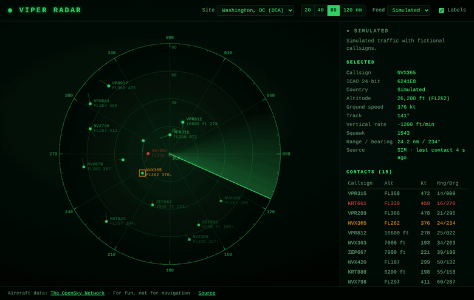
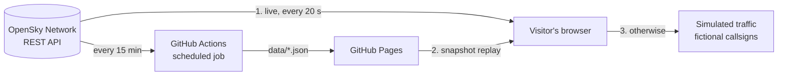

# ◉ Viper Radar

A retro radar scope that shows **live aircraft** around Washington DC, New York or Los Angeles, using real ADS-B data from the [OpenSky Network](https://opensky-network.org).
A rotating sweep "paints" each aircraft as it passes, blips fade like phosphor on an old CRT, and positions are dead-reckoned between updates.

**[▶ Live demo](https://viepertech.github.io/viper-radar/)** · no install, no API key



## Features

- **Rotating sweep with phosphor decay:** a contact only appears when the sweep crosses its bearing, then fades with an exponential decay (brightness = e<sup>−t/τ</sup>, τ ≈ 3.6 s), leaving a short trail of earlier paints.
- **Dead reckoning:** between data updates each aircraft is moved along its reported track at its ground speed, so blips advance smoothly instead of jumping.
- **Aviation details:** altitude in feet below 18,000 ft and as a flight level above it (FL350), a one-minute velocity leader on each blip, climb/descent arrows, and squawk codes. Emergency squawks (7500, 7600, 7700) turn red.
- **Click any blip or table row** for callsign, ICAO address, altitude, speed, track, vertical rate, range and bearing.
- **Label decluttering:** the brightest data blocks are drawn first, and any that would overlap are skipped.
- **Range 20–120 nm** (buttons or mouse wheel), three radar sites, and shareable URLs such as `?region=nyc&range=40`.
- **Always works:** the page falls back automatically when live data isn't reachable (see below).

## How the data gets there



1. **Live:** the browser calls the OpenSky API directly (one request covers the whole scope).
2. **Snapshot:** if the browser can't reach OpenSky (blocked, rate-limited or offline), it loads the snapshot that a scheduled GitHub Actions job saved with the site, and replays it with dead reckoning. The status panel shows how old it is.
3. **Simulated:** if neither is available, it shows clearly labelled simulated traffic. You can also pick *Simulated* from the Feed menu.

**Rate-limit budget.** Each site's box is kept under 25 square degrees, so a request costs 1 OpenSky credit. The snapshot job uses 3 credits every 15 minutes, about 288 per day, under the 400/day anonymous limit. Live polling pauses when the tab is hidden.

## Physics and maths

All of it is in [`js/geo.js`](js/geo.js) and covered by unit tests:

- **Local projection:** within 120 nm a flat projection is accurate enough: x = Δλ · 60 · cos φ₀, y = Δφ · 60 (nautical miles, since 1° of latitude = 60 nm).
- **Range and bearing:** r = √(x² + y²), θ = atan2(x, y).
- **Dead reckoning:** distance d = v · Δt; Δφ = d cos(track) / 60, Δλ = d sin(track) / (60 cos φ).
- **Sweep painting:** each frame, any contact whose bearing lies between the previous and current sweep angle is painted (with wrap-around at 360°).

## Run it locally

ES modules need a web server (opening `index.html` as a file won't load them):

```bash
python3 -m http.server 8000      # then open http://localhost:8000
npm test                         # 13 unit tests (Node 20+, no dependencies)
npm run snapshot                 # fetch data/*.json from OpenSky yourself
```

## Deploy your own

1. Push this repo to GitHub.
2. **Settings → Pages → Build and deployment → Source: GitHub Actions.**
3. The workflow runs on every push and every 15 minutes: tests → snapshot → deploy.
4. *Optional but recommended:* GitHub's runners share IP addresses, so anonymous OpenSky requests from Actions can hit the rate limit. Create a free OpenSky account, add an API client on your account page, and save it as repository secrets `OPENSKY_CLIENT_ID` and `OPENSKY_CLIENT_SECRET` (4,000 credits/day).

GitHub pauses scheduled workflows in repos with no activity for 60 days; any push or a manual *Run workflow* turns them back on.

## Project structure

```
index.html              page layout
css/style.css           phosphor-green theme
js/main.js              data sources, fallback chain, side panel, controls
js/radar.js             canvas scope: sweep, painting, decay, labels, picking
js/geo.js               projection, range/bearing, dead reckoning, units
js/opensky.js           OpenSky URL builder and response parser
js/sim.js               seeded simulated traffic
js/regions.js           radar sites and 1-credit bounding boxes
scripts/fetch-snapshot.mjs   Node script run by GitHub Actions
test/radar.test.mjs     unit tests (node:test)
```

## Credits

Aircraft data © [The OpenSky Network](https://opensky-network.org), used under its non-commercial terms. Viper Radar is a hobby visualization and **must not be used for navigation**.

Built by [Alexander RN Murphy](https://github.com/Viepertech).
